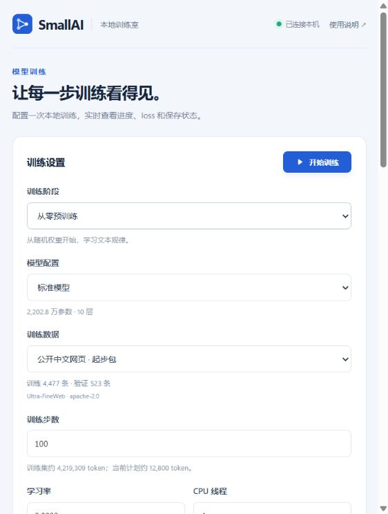

# SmallAI：本机从零训练中文实验模型

本项目按你的选择开发：**随机初始化、不加载预训练权重、只用本机 CPU**。第一阶段目标是跑通中文分词、预训练、对话训练、工具调用和本地验证。

**这是一套可运行的训练程序与实验权重，尚未达到 MiniCPM 的聊天或工具调用水平。** 示例数据用于检查流程；把训练步数调大，并不能让这份小语料变成通用知识。

首轮模型实验完成了 100 步预训练和两轮各 200 步 SFT。该实验的最新权重在 8 个工具问题中生成了 3 个合法调用，但完全正确的调用为 **0/8**。加入可视化界面和公开数据后，完整开发检查 **44 项通过**。首轮模型结果见 `实验结果.md`，新数据见 `公开数据接入记录.md`。

## 从 GitHub 下载后启动

仓库包含训练代码、本地界面、配置、少量自写示例和实验说明。大语料、下载缓存、训练权重、虚拟环境与本机依赖不随仓库上传。下面的历史实验路径需要在自己的电脑上重新生成。

在项目目录安装 CPU 依赖并打开界面：

```powershell
python -m venv .venv
.venv\Scripts\python.exe -m pip install torch --index-url https://download.pytorch.org/whl/cpu
.venv\Scripts\python.exe -m pip install -e ".[data]"
.venv\Scripts\python.exe -m smallai ui
```

首次打开后，在「公开训练数据」点击「获取数据」。准备完成后选择公开中文网页做从零预训练，再使用对应的权重做对话与工具训练。



## 现在就用

**可视化训练：双击 `启动训练界面.cmd`，打开本机训练控制台。** 也可以运行：

```powershell
python -m smallai ui
```

界面地址为 `http://127.0.0.1:8765`，不需要新增依赖。选择训练阶段与参数，点击「开始训练」即可查看进度条、当前步数、训练/验证 loss、曲线、速度、预计剩余时间和日志。

- 「停止并保存」会在当前一步结束后保存权重与优化器状态。
- 「继续训练」沿用原参数，完成同一份计划剩余的步数。
- 刷新或关闭页面不影响训练；重新打开可查看进度与历史记录。
- 每次新训练保存到 `outputs/gui/` 下的新目录，保留原有实验权重。
- 没有训练运行时，可点页面底部的「关闭界面服务」退出。

先保留默认的 100 步、4 个线程即可检查界面。训练进度达到 100% 只表示计划步数完成，模型质量仍需单独评测。

在本目录打开 PowerShell：

```powershell
# 查看本机依赖
python -m smallai doctor

# 从分词到工具评测，重新检查一遍完整流程（使用极小模型）
python -m smallai smoke

# 与已经生成的 CPU 实验权重对话
python -m smallai chat --checkpoint outputs/cpu_demo/refined/last.pt

# 查看约 2200 万参数的结构配置
python -m smallai inspect
```

也可以双击 `开始聊天.cmd` 进入对话，或双击 `运行检查.cmd` 检查流程。`开始.cmd` 显示全部命令，命令行可运行 `开始.cmd smoke`。

聊天时 `/reset` 清空历史，`/exit` 退出。实验权重可能生成乱码、不完整的回答或错误工具参数；具体能力以评测结果为准。已经确认能工作的计算器运行时，与模型能否正确选择和填写工具参数，是两个不同的检查项。

当前开发机为 i5-13420H、约 16GB 内存、Intel 核显。程序使用 CPU 和 float32，默认 4 个线程，不需要显卡、模型 API 或云服务。依赖已在当前 Python 中检测并实际运行。

## 公开数据

界面现已支持下载和准备公开数据，也可运行：

```powershell
python -m smallai public-data --web-docs 5000 --chat-rows 1500 --tool-rows 1500
```

本次已接入的起步包包含 5000 篇中文网页、709 组中文根问答和 1276 条单次函数调用。按 1024 token 上下文筛选并平衡普通问答与工具样本后，共编码 1387 条 SFT 对话；预训练语料共约 470 万 token。实际计数、文件摘要与转换记录保存在各数据包的 `sources.json`。

| 用途 | 公开来源 | 标注授权 |
| --- | --- | --- |
| 中文预训练 | [OpenBMB / Ultra-FineWeb 中文部分](https://huggingface.co/datasets/openbmb/Ultra-FineWeb) | Apache-2.0 |
| 中文问答 | [OpenAssistant / oasst2](https://huggingface.co/datasets/OpenAssistant/oasst2) | Apache-2.0 |
| 中文函数调用 | [twinkle-ai / tw-function-call-reasoning-10k](https://huggingface.co/datasets/twinkle-ai/tw-function-call-reasoning-10k) | CC-BY-4.0 |

函数调用数据为公开的繁体中文翻译合成数据。只保留当前模型支持的单次调用，省略推理字段，最多保留三个候选工具，规范化参数类型并缩短过长描述。普通问答只保留每个根问题的一份较优回复。OpenAssistant 使用 ready export 原始消息，自行划分训练/验证集；网页分页接口的上游转换版本不能固定，已保留下载时观察到的仓库版本和本地文件 SHA-256。

每份公开数据配套**新训练的 16384 词表分词器**，不会覆盖 `data/tokenizer.json`。界面根据数据集选择对应分词器，只列出兼容的 SFT 权重。因此应先用公开数据从零预训练，再用该次权重做对话与工具训练。旧示例数据和权重仍可选择。

下载缓存位于 `data/cache/public/`，原始转换数据与来源记录位于 `data/public/`，可直接训练的数据位于 `data/prepared/`。接口限流时会自动等待并复用缓存。每次重新准备会生成一个新数据包。原始函数调用文件使用 DuckDB 读取；当前读取器位于项目 `vendor/`。迁移到其他环境可安装 `duckdb>=1.3,<2`，或安装项目的 `data` 可选依赖。

这是适合本机试训的公开来源子集；训练进度和 loss 不等同于达到 MiniCPM 能力。数据中的外部函数定义用于训练格式与参数选择，不会自动注册或执行那些 API。

## 模型规模

| 项目 | 默认配置 |
| --- | --- |
| 结构 | 仅解码器 Transformer，自回归语言模型 |
| 层数 / 隐藏维度 | 10 / 384 |
| 查询头 / KV 头 | 6 / 2，GQA |
| 前馈维度 | 1024，SwiGLU |
| 位置编码 / 归一化 | RoPE / RMSNorm |
| 输入与输出词嵌入 | 共享权重 |
| 目标词表 / 上下文上限 | 16384 / 1024 token |
| 满词表参数量 | **22,028,160** |
| 满词表 float32 权重 | 约 84 MiB |

实际模型使用自行训练的分词器的真实词表。小语料只能学到较少的合并规则，所以当前示例词表为 **1066**，实际实验模型为 **16,146,048 参数**。这是正常现象。

`configs/smoke.json` 是完整流程检查专用的极小模型。检查通过说明程序可运行，不能把它的效果等同于默认模型。

`inspect` 的训练状态内存估算包含权重、梯度和 Adam 的两组状态，**不包含**激活、注意力矩阵、临时张量及 Python/PyTorch 开销。运行速度可自行测量：

```powershell
python -m smallai benchmark --threads 4 --block-size 128
```

短时测试受温度、线程数、其他程序和序列长度影响。SFT 对话比预训练的短文本块长，不能直接套用相同速度。

## 文件在哪里

| 路径 | 内容 |
| --- | --- |
| `smallai/model.py` | 模型与带 KV cache 的生成 |
| `smallai/tokenizer.py` | 从本地文本训练 byte-level BPE |
| `smallai/data.py` | 去重、划分、对话编码、磁盘映射数据集 |
| `smallai/training.py` | 预训练、SFT、验证、checkpoint 与续训 |
| `smallai/tools.py` | 工具定义、调用解析、计算器和时钟 |
| `smallai/inference.py` | 本地对话与工具评测 |
| `smallai/ui.py`、`smallai/web/` | 本机训练控制台与界面 |
| `data/demo/` | 自写的流程测试数据 |
| `data/tokenizer.json` | 本次从零训练的分词器 |
| `data/prepared/` | 编码后的训练集、验证集和文件摘要 |
| `outputs/cpu_demo/` | 本次 CPU 实验的权重、日志与结果 |
| `outputs/cpu_demo/refined/last.pt` | 当前对话入口使用的最新实验权重 |
| `outputs/gui/` | 从可视化界面启动的训练及历史记录 |
| `outputs/verified_check/` | 完整流程检查报告 |
| `tests/` | 模型正确性、数据、续训、工具及评测检查 |

## 从空数据开始训练

本目录已准备好示例数据和分词器。下面是重建流程，用于理解和迁移；已有文件会被保护，重新试验时请更换相应输出路径。

### 1. 准备语料

```powershell
python -m smallai demo-data --output data/demo
```

这会创建 133 条预训练文本、128 条对话和 12 个工具评测样例。时间查询对话中的日期是虚构示例，实际工具读取当前时钟。算术测试使用不同的数字，但与训练样例共享模板，因此这些分数只能用于开发检查。

换成更充足的中文文本时，预训练 JSONL 每行一个对象：

```json
{"text":"这里是一篇完整的中文文本。"}
{"text":"这里是另一篇文本。"}
```

也支持 UTF-8 `.txt`，以空行分隔不同文档。可以通过 `--input 文件1 文件2` 输入多个文件。准备程序按文档内容的 SHA-256 划分训练/验证集，并移除完全重复的文档；它没有执行近重复检测或内容质量筛选。

### 2. 训练自己的分词器

```powershell
python -m smallai tokenizer --input data/demo/corpus.jsonl --output data/tokenizer.json --vocab-size 16384
```

分词器只使用同一哈希规则划分出的训练部分。Byte-level 编码可以覆盖未见过的汉字和表情，较小的词表会使部分文字变成更长的 token 序列。

**开始训练权重后要固定分词器。** 更换词表需重新训练模型。程序通过摘要检查分词器与数据集、checkpoint 的对应关系。

### 3. 编码数据

```powershell
python -m smallai prepare --stage pretrain --input data/demo/corpus.jsonl --output data/prepared/pretrain
python -m smallai prepare --stage sft --input data/demo/sft.jsonl --output data/prepared/sft --block-size 1023
```

预训练文本在划分后分别打包。SFT 保留完整对话，使用右侧填充，只对 assistant 的内容、工具调用和结束标记计算 loss；system、user、tool 返回值及填充不作为学习目标。

超长对话不会被从中间截断，会统计到 `manifest.json` 的 `too_long_skipped`。应检查此值，按需要缩短数据或调整上下文配置。当前示例的 128 条对话在 `block-size=1023` 时全部保留。

### 4. 从随机权重预训练

```powershell
python -m smallai train --stage pretrain --data data/prepared/pretrain --output outputs/my_run/pretrain --config configs/cpu_22m.json --steps 200 --block-size 128 --threads 4
```

`--steps` 表示优化器更新次数。预训练每步的有效目标 token 数为 `batch-size × block-size × accumulation`。200 步、128 长度、批大小 1 只处理 25,600 个目标 token，属于流程实验规模。

训练写入 `last.pt`、`metrics.jsonl`、`config.json` 和 `summary.json`。验证 loss 用于检查预测损失，不等同于聊天质量。

### 5. 用自己的预训练权重进行对话与工具训练

```powershell
python -m smallai train --stage sft --data data/prepared/sft --output outputs/my_run/sft --init-from outputs/my_run/pretrain/last.pt --steps 200 --block-size 1023 --learning-rate 0.0001 --threads 4
```

`--init-from` 载入本项目 checkpoint 的模型参数，开始一份新的优化计划，优化器状态会重新初始化。模型结构和词表沿用该 checkpoint。

本次开发还从第一轮 SFT 权重开始，在 `outputs/cpu_demo/refined/` 中额外训练了 200 步，学习率为 0.0003。两轮模型的工具评测均已保留，见 `实验结果.md`。

### 6. 对话与评测

```powershell
python -m smallai chat --checkpoint outputs/my_run/sft/last.pt
python -m smallai evaluate --checkpoint outputs/my_run/sft/last.pt --data data/demo/eval_tools.jsonl --output outputs/my_run/tool_evaluation.json
```

评测分别记录完整调用格式、工具选择、工具名与参数的精确匹配、执行结果以及无需工具时是否避免调用。**当前评测只衡量首次工具决策，没有衡量最终回答质量、多轮成功率或通用中文水平。** 无需工具时生成的乱码也可能被计为“未调用”，应结合原始输出阅读报告。

## 暂停和续训

训练过程中按 `Ctrl+C`，程序保存当前模型、优化器、步数和随机状态后退出。例如原计划为 200 步：

```powershell
python -m smallai train --stage pretrain --data data/prepared/pretrain --output outputs/my_run/pretrain --steps 200 --block-size 128 --threads 4 --resume outputs/my_run/pretrain/last.pt
```

`--resume` 必须保持原阶段、数据、计划总步数、学习率、批大小、梯度累积和 seed。这里的 200 是原计划的总步数，不是额外再训 200 步。需要更改计划时，使用 `--init-from` 并更换输出目录。

## 工具调用格式

当前内置两个本地工具：

- `calculator(expression)`：四则运算、括号、小整数幂。
- `get_current_time(timezone)`：`Asia/Shanghai` 或 `UTC` 的当前时间。

工具调用是模型生成的结构化输出：

```text
<|tool_call|>{"name":"calculator","arguments":{"expression":"17 * 23"}}<|tool_end|>
```

运行时检查完整标记、JSON、工具名和参数，执行已注册工具，再把结果交回模型。计算器使用受限的语法树求值，没有使用 `eval`。普通输入中的角色标记按文本编码，不能插入新的消息角色。

SFT 数据使用消息列表，支持常见的 `function` 嵌套结构；`arguments` 可以是 JSON 字符串或对象：

```json
{"tools":[{"type":"function","function":{"name":"calculator","description":"计算算式","parameters":{"type":"object","properties":{"expression":{"type":"string"}},"required":["expression"]}}}],"messages":[{"role":"user","content":"请计算 17 * 23。"},{"role":"assistant","content":null,"tool_calls":[{"id":"call_0","type":"function","function":{"name":"calculator","arguments":"{\"expression\":\"17 * 23\"}"}}]},{"role":"tool","name":"calculator","tool_call_id":"call_0","content":"{\"result\":391}"},{"role":"assistant","content":"17 × 23 = 391。"}]}
```

第一版每个 assistant 消息只支持一个工具调用；本地对话每次提问最多自动执行两个工具调用，随后停止继续调用。添加工具需要同时增加定义、执行函数和相应训练/测试样例。

## 运行测试

```powershell
python -m pytest -q
```

测试覆盖：未来 token 不影响过去的预测、KV cache 与完整推理一致、预测目标移位、SFT loss 遮罩、中文编码往返、去重划分、从中间 checkpoint 续训与不中断训练一致、工具执行及评测计分。

## 依赖和技术参考

当前机器的 Python 已具备依赖。换到新环境时，可创建虚拟环境，再安装：

```powershell
python -m pip install torch --index-url https://download.pytorch.org/whl/cpu
python -m pip install "tokenizers>=0.20,<1" "numpy>=1.26,<3" "pytest>=8,<10"
```

- [PyTorch 的因果注意力接口](https://docs.pytorch.org/docs/2.14/generated/torch.nn.functional.scaled_dot_product_attention.html)
- [Hugging Face Tokenizers 从零训练分词器](https://huggingface.co/docs/tokenizers/quicktour)
- [MiniCPM5-1B 官方模型卡](https://huggingface.co/openbmb/MiniCPM5-1B)：作为后续比较的候选基线，本项目没有载入其权重。

后续应先扩充和筛选中文语料，加入多样的对话、无需工具、参数缺失、工具失败和多轮样例，再固定独立测试集。基于实际训练速度与测试结果决定模型规模；通用能力尚需实测。
